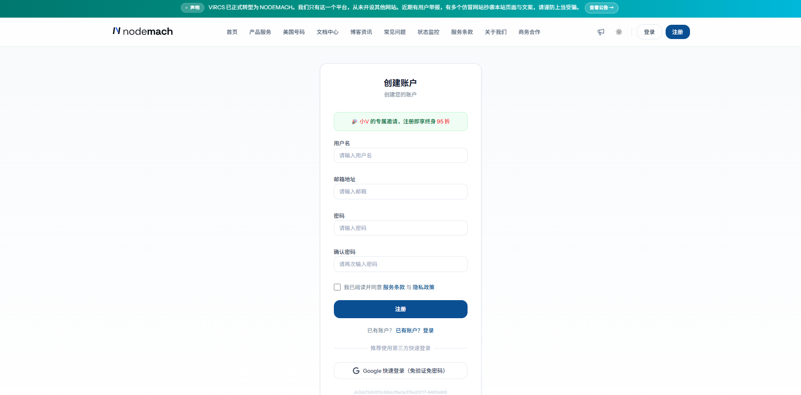
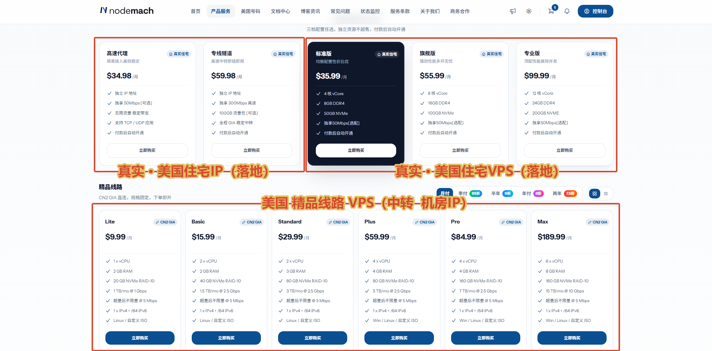

---
hide:
  - navigation
  - toc
---

---

# NodeMach 注册与购买图文教程

本文介绍如何通过小V专属邀请注册、区分产品类型，并以 **CN2 GIA Lite** 为例完成选购。

## 一、通过邀请入口注册

👉 **[点击进入小V专属邀请页面，注册享终身95折](https://www.nodemach.com/welcome?vcd=9467e966)**

打开后，先确认页面出现绿色提示：**「小V的专属邀请，注册即享终身95折」**，再填写用户名、邮箱和密码，阅读服务条款与隐私政策后完成注册。

> 如果没有看到专属邀请提示，请重新通过上方邀请入口打开页面，再进行注册。已有账户的邀请归属不会因点击链接而改变。

## 二、进入产品服务，选择产品类型

注册并登录后，点击顶部导航中的 **「产品服务」**。图中三个区域分别对应：

* 产品说明，不清楚的可以咨询博主

**注意：下方 CN2 GIA 系列属于机房 IP VPS，不属于住宅 IP 产品。**

