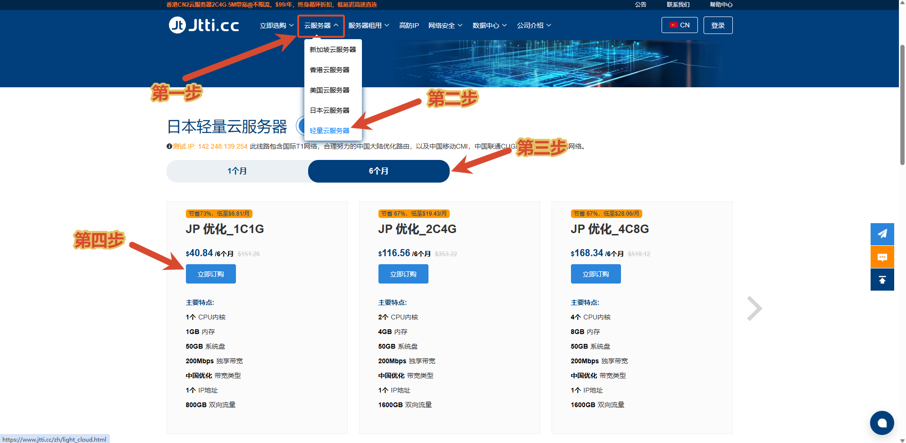
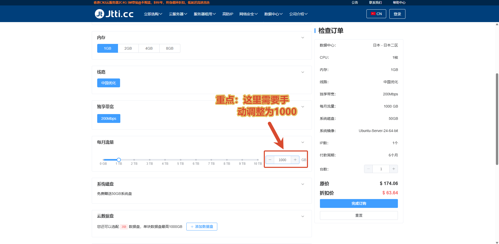
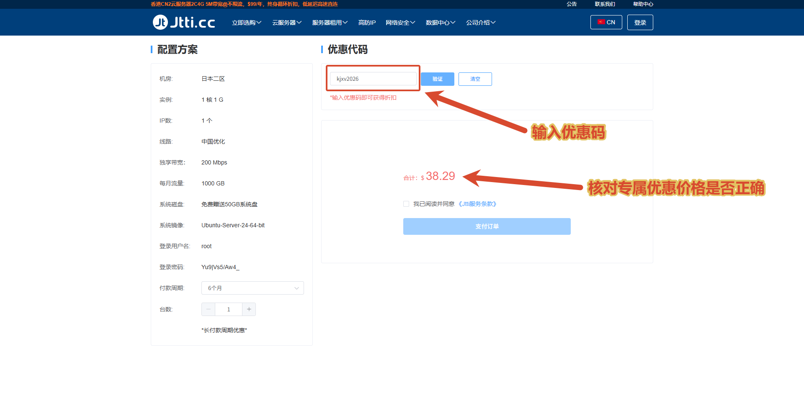

---
hide:
  - navigation
  - toc
---

---

# JTTI 专属优惠 VPS 下单教程

## 第一步：选择套餐

进入官网，依次点击「云服务器 → 轻量云服务器」，选择香港或日本地区，将付款周期切换为 **6个月**，再点击 **1核1G** 套餐的「立即订购」。下图以日本套餐为例。

## 第二步：手动将流量改为 1000GB（重点）

在配置页面，将「每月流量」从默认的 **800GB 手动调整为 1000GB**。

> **必须先改流量，再使用优惠码。** 如果保留 800GB，系统无法匹配专属套餐，输入优惠码后也不会显示对应的优惠价格。

## 第三步：输入优惠码，核对价格

进入结算页面，输入优惠码 `kjxv2026`，点击「验证」。确认付款周期为 **6个月**，总价为 **香港 $39.56 / 日本 $38.29**，核对无误后再付款。

---

## 🔥 本教程适用套餐

本教程用于购买 **JTTI 香港 / 日本轻量云服务器的站长专属优惠套餐**，帮助新手正确配置流量并使用优惠码。

两款均为：**1核1G｜每月1000GB流量｜200Mbps独享带宽｜中国优化线路**。

| 地区 | 专属半年价 | 折算月价 |
| --- | --- | --- |
| 香港 HK | **$39.56 / 半年** | 约 $6.59 / 月 |
| 日本 JP | **$38.29 / 半年** | 约 $6.38 / 月 |

✅ 站长专属优惠，非官网公开价；使用优惠码下单更划算。

**下单记得填写优惠码：`kjxv2026`**

👉 [点击进入 JTTI 专属购买页面](https://www.jtti.cc/zh/light_cloud.html?k=T7KBH7)

