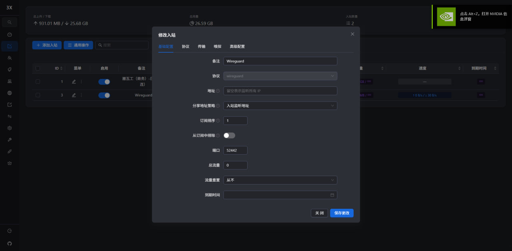
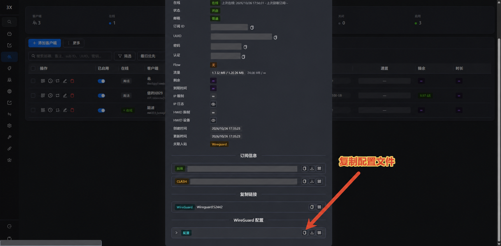
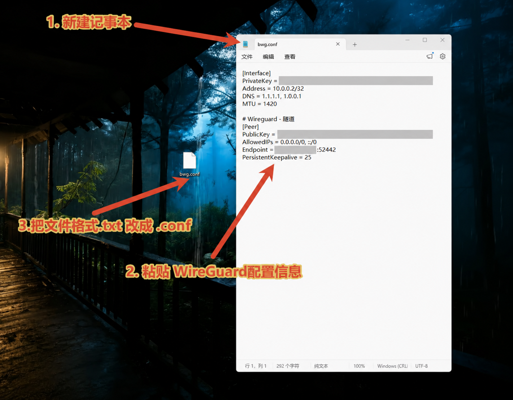
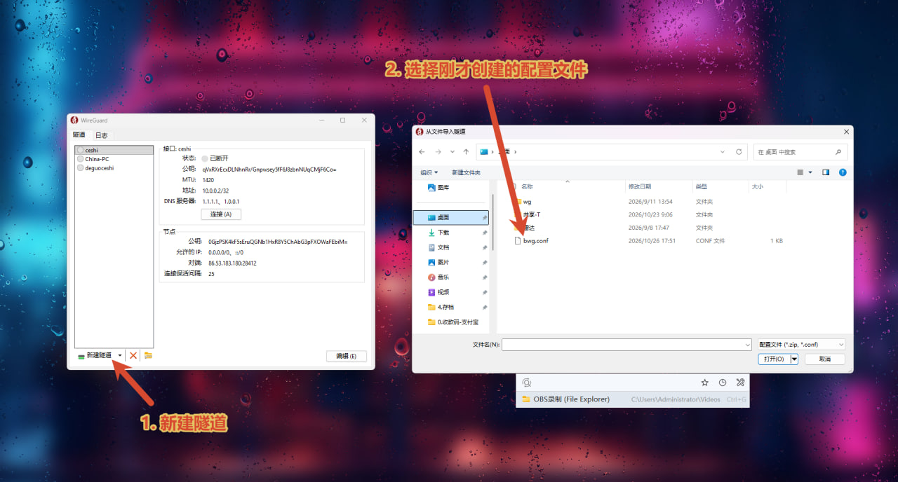
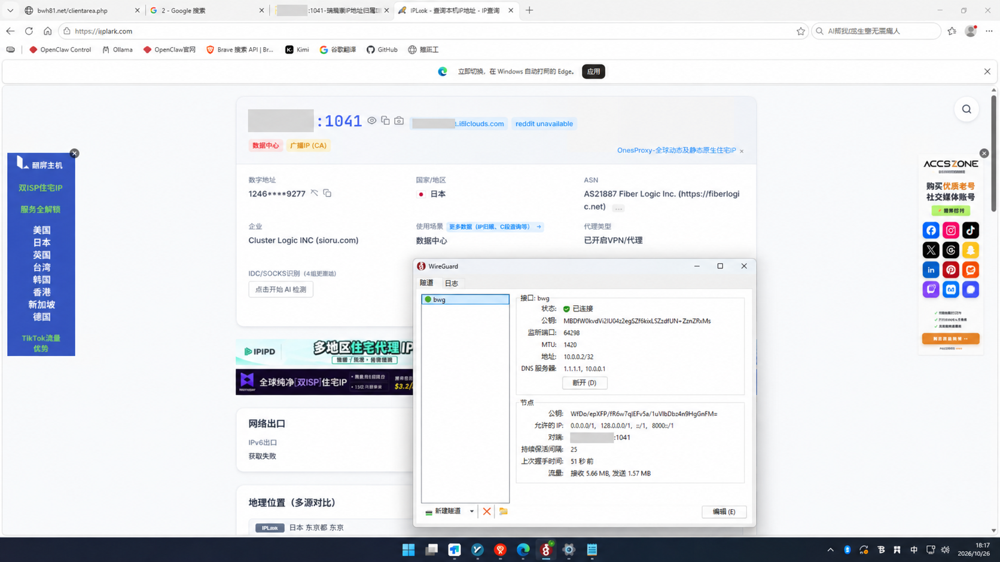
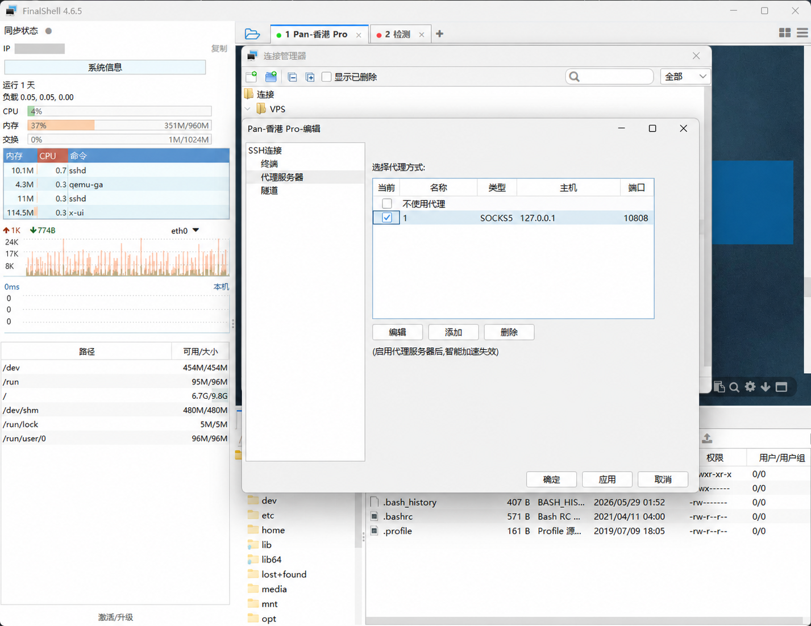
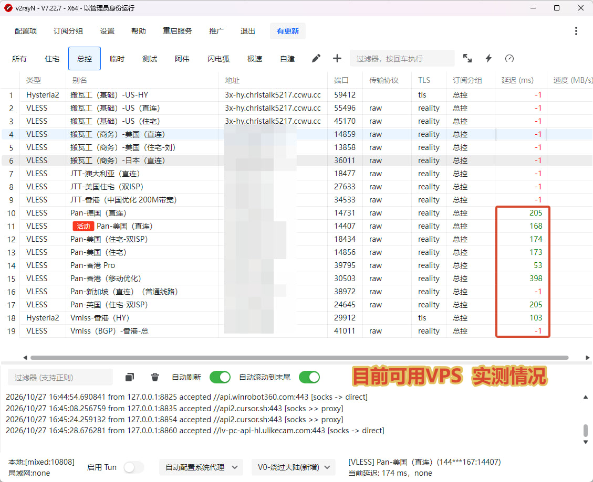
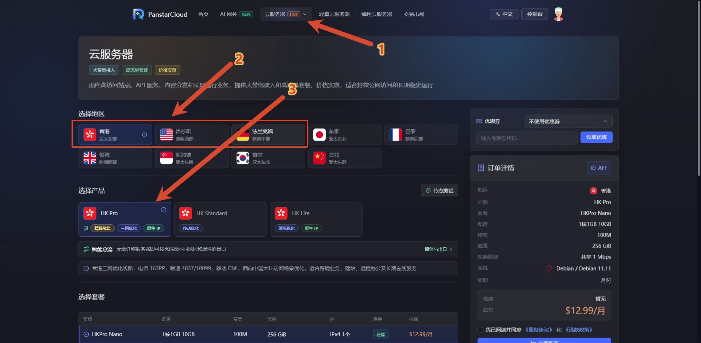
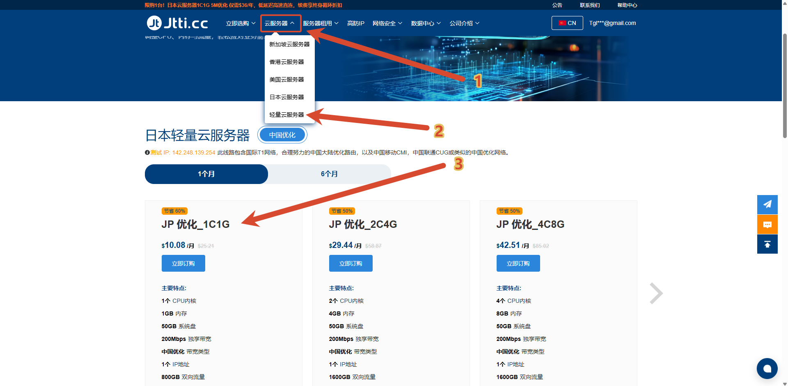

---
hide:
  - navigation
  - toc
---

<style>
  /* 与博客文章正文保持接近的阅读宽度 */
  .md-content__inner {
    max-width: 765px !important;
    margin: 0 auto !important;
  }

  .emergency-nav {
    display: grid;
    grid-template-columns: repeat(3, minmax(0, 1fr));
    gap: 0.6rem;
    margin: 1.2rem 0 1.6rem;
  }

  .emergency-nav a {
    display: flex;
    align-items: center;
    justify-content: center;
    min-height: 3.2rem;
    padding: 0.65rem 0.75rem;
    border: 1px solid var(--md-default-fg-color--lightest);
    border-radius: 0.55rem;
    background: var(--md-default-bg-color);
    color: var(--md-typeset-a-color);
    font-weight: 700;
    line-height: 1.45;
    text-align: center;
    transition: border-color 0.15s ease, transform 0.15s ease, box-shadow 0.15s ease;
  }

  .emergency-nav a:hover {
    border-color: var(--md-accent-fg-color);
    transform: translateY(-1px);
    box-shadow: 0 0.25rem 0.8rem rgba(0, 0, 0, 0.08);
  }

  .md-typeset h2[id] {
    scroll-margin-top: 5rem;
  }

  @media screen and (max-width: 44.984375em) {
    .emergency-nav {
      grid-template-columns: 1fr;
    }
  }
</style>

---

# VPS 与机场节点不可用应急方案

近期很多厂商的 VPS 和机场节点可能出现无法使用的情况。以下是目前整理的三种解决方案，有需要的读者可以根据实际情况选择；后续有新的可用方案，本文也会持续更新。

1. **方案一：WireGuard 隧道**——适合仍能登录 3X-UI 控制台，并且可以接受使用机房 IP 的用户。
2. **方案二：Sing-box 部署 Hy 节点**——适合仍能通过 SSH 直接连接 VPS，或能借助本地代理连接 VPS 的用户。
3. **方案三：选择目前可用的 VPS**——例如 Panstar 美国 VPS、德国 9929 VPS、香港 Pro VPS。 Jtti 日本轻量云。

!!! warning "开始前请确认"
    方案一和方案二均属于临时应急办法，不能把机房 IP 变成住宅 IP。操作前请保留原有节点和配置，不要直接删除仍可能恢复的入站。远程脚本会以服务器权限执行，运行前请确认来源可信并自行评估风险。

<nav class="emergency-nav" aria-label="应急方案快速导航">
  <a href="#plan-1-wireguard">方案一<br>WireGuard 隧道</a>
  <a href="#plan-2-singbox">方案二<br>Sing-box 部署 Hy 节点</a>
  <a href="#plan-3-vps">方案三<br>选择目前可用的 VPS</a>
</nav>

## 方案一：WireGuard 隧道 { #plan-1-wireguard }

### 适用条件

使用本方案前，请确认：

- 目前仍然可以登录服务器上的 **3X-UI 控制台**；
- 服务器本身仍可访问互联网；
- 可以在服务商防火墙或安全组中放行一个 **UDP 端口**；
- 能够接受临时使用 VPS 的机房 IP，而不是住宅 IP。

Windows 用户还需要提前安装 [WireGuard 官方客户端](https://www.wireguard.com/install/)。

### 第一步：在 3X-UI 中创建 WireGuard 入站

进入 3X-UI 的入站列表，点击 **「添加入站」**。协议选择 **WireGuard**，填写一个便于识别的备注，并设置一个未被占用的高位端口。

截图中使用的端口仅作演示。实际操作时，请使用自己设置的端口，并在 VPS 服务商的防火墙、安全组和系统防火墙中放行对应的 **UDP 端口**。



完成后点击 **「保存更改」**，确认新建的 WireGuard 入站处于启用状态。

### 第二步：复制 WireGuard 配置

进入对应客户端的详情页面，在 **「WireGuard 配置」** 一栏找到复制按钮，复制系统自动生成的完整配置内容。



!!! danger "配置文件属于敏感信息"
    WireGuard 配置中包含私钥和服务器连接信息。请只使用自己控制台生成的配置，不要把配置全文、二维码、私钥或订阅信息发到公开群组和网站。

### 第三步：保存为 `.conf` 配置文件

在电脑桌面新建一个记事本文档，将刚才复制的内容完整粘贴进去，然后执行以下操作：

1. 点击记事本的 **「文件 → 另存为」**；
2. 将文件名改为容易识别的名称，例如 `emergency-wg.conf`；
3. 确认文件扩展名是 **`.conf`**，而不是 `.txt`；
4. 编码建议保留为 **UTF-8**。



> 图片中的敏感内容已经隐藏。请不要照抄截图中的参数，应当使用自己在 3X-UI 中复制的完整配置。

### 第四步：导入 WireGuard 客户端

打开 Windows 版 WireGuard，点击左下角 **「新建隧道」** 旁边的下拉菜单，选择 **「从文件导入隧道」**，然后选择刚才保存的 `.conf` 文件。



导入成功后，选中刚创建的隧道，点击 **「连接」或「启用」**。

### 第五步：检查连接是否生效

连接后重点检查以下内容：

- WireGuard 客户端显示 **「已连接」**；
- 有最近握手时间，并且接收、发送流量会变化；
- 浏览器查询到的出口 IP 已经变成 VPS 的机房 IP；
- 常用网页和必要服务可以正常打开。



!!! tip "使用结束后"
    这是应急连接。原有线路恢复后，可以先停用 WireGuard 隧道；确认不再需要时，再删除本地配置文件和 3X-UI 中对应的临时入站。

### 方案一常见问题排查

#### 客户端一直没有握手

优先检查以下几项：

1. VPS 服务商的安全组是否放行了对应的 **UDP 端口**；
2. 系统防火墙是否允许该端口；
3. 配置文件中的 `Endpoint` 地址和端口是否完整；
4. 3X-UI 中的 WireGuard 入站是否已启用；
5. 当前网络是否仍能访问这台 VPS 的公网 IP。

#### 显示已连接，但无法打开网页

可以依次检查：

- 配置中的 DNS 是否可用；
- `AllowedIPs` 是否包含 `0.0.0.0/0` 和 `::/0`；
- 服务器转发、NAT 和出口网络是否正常；
- 重新在 3X-UI 中生成配置并再次导入。

#### 无法登录 3X-UI，或者服务器公网 IP 完全不可达

这种情况下无法依靠 3X-UI 临时创建 WireGuard 连接。如果还能通过 SSH 或本地代理连接服务器，可以继续尝试方案二；如果服务器已经完全不可达，请直接考虑方案三。

---

## 方案二：Sing-box 部署 Hy 节点 { #plan-2-singbox }

这个方案同样属于临时应急方案。前提是服务器仍然可以通过 SSH 连接：能够直连时正常登录即可；无法直连但本地代理可用时，可以让 SSH 客户端通过本地代理连接 VPS。

### 适用条件

- 仍能通过 SSH 直接连接 VPS，或可借助本地代理完成连接；
- 拥有服务器的 `root` 权限，或可以使用 `sudo` 切换到 `root`；
- VPS 本身可以访问互联网；
- 可以在服务商安全组和系统防火墙中放行脚本生成的端口。

### 第一步：必要时为 FinalShell 设置本地代理

如果 FinalShell 无法直接连接 VPS，可以打开对应连接的编辑页面，进入 **「代理服务器」**，添加或选中本地代理：

- 代理类型选择 **SOCKS5**；
- 主机填写 `127.0.0.1`；
- 使用 v2rayN 时，截图中的本地 SOCKS 端口为 `10808`；
- 使用其他代理软件时，请填写该软件实际显示的本地 SOCKS 端口，不要直接照抄 `10808`；
- 设置前请确认本地代理软件已经启动并能正常使用。



> 这里的代理只用于帮助 FinalShell 建立 SSH 连接，并不是新部署的 Hy 节点端口。

### 第二步：运行 Sing-box 一键部署脚本

连接 VPS 后，先切换到 `root` 用户：

```bash
sudo -i
```

然后运行以下命令：

```bash
bash <(wget -qO- https://raw.githubusercontent.com/kjxv/sing-box/main/sing-box.sh)
```

脚本交互界面出现后，根据提示选择语言和安装选项；协议类型选择 **Hysteria2（Hy）**。完成部署后，请记录脚本生成的端口，并在服务商安全组和系统防火墙中放行对应端口。

!!! danger "运行远程脚本前请确认"
    上面的命令会下载并以服务器权限直接执行脚本。建议先打开 [kjxv/sing-box 项目页面](https://github.com/kjxv/sing-box) 查看来源和更新记录。谨慎操作时，也可以先下载并检查脚本，再手动执行：

    ```bash
    wget -O sing-box.sh https://raw.githubusercontent.com/kjxv/sing-box/main/sing-box.sh
    less sing-box.sh
    bash sing-box.sh
    ```

### 第三步：导出并测试 Hy 节点

安装完成后，可以运行下面的快捷命令查看节点信息：

```bash
sb -n
```

复制生成的 Hysteria2 节点链接，导入 v2rayN 等兼容客户端后进行延迟和连接测试。如果节点无法使用，请优先检查：

1. 安全组和系统防火墙是否放行了生成的端口；
2. 客户端是否支持 Hysteria2；
3. VPS 的公网 IP 是否仍然可以从当前网络访问；
4. 服务器时间、域名解析和出站网络是否正常。

> Sing-box 方案依赖原 VPS 仍可连接和正常出网。如果服务器公网 IP 已经完全不可达，应直接使用方案三更换 VPS。

---

## 方案三：选择目前可用的 VPS { #plan-3-vps }

如果原服务器已经无法使用，或者需要继续搭建住宅 IP 出口，可以先选择一台当前连接正常的 VPS 作为中转或基础服务器，再在其后配置自己合法持有或授权使用的住宅 IP 服务。

根据 **2026 年 10 月 27 日** 的测试结果，Panstar 以下几个方向目前可以正常连接：

| 备选产品 | 更适合的场景 |
| --- | --- |
| 美国三网精品 VPS | 面向美国方向使用，作为临时中转或住宅 IP 前置服务器 |
| 德国 9929 VPS | 需要欧洲地区出口或中欧方向连接的用户 |
| 香港 Pro VPS | 更看重亚洲地区延迟和香港方向连接的用户 |



!!! info "测试结果具有时效性"
    截图只代表测试当时的网络情况。线路状态、延迟、库存和价格都可能发生变化，购买前建议先月付测试，并以官网实时显示为准。

- [进入 Panstar 注册页面](https://panstar.ai/register?aff=DCAD1VCH)


---

- [进入 Jtti 注册页面](https://www.jtti.cc?k=T7KBH7)

- [查看本站 VPS 实测推荐与套餐说明](../../recommend/1-vps/index.md)

> **注意：** VPS 本身通常属于机房 IP。若最终目标是住宅 IP，需要在可用 VPS 上继续配置合规的住宅代理或 ISP 出口；购买 Panstar VPS 并不等于直接获得住宅 IP。

---

## 如何选择

- **还能登录 3X-UI，只是现有协议节点暂时不可用：** 优先尝试方案一。
- **还能通过 SSH 直连，或能通过本地代理登录 VPS：** 可以尝试方案二部署 Hy 节点。
- **服务器 IP 已经完全无法连接：** 直接使用方案三，更换一台当前可用的 VPS。
- **必须使用住宅 IP：** 先按方案三准备可用的中转 VPS，再连接自己拥有使用权限的住宅 IP 服务。

本文方案仅用于正常的网络维护、远程办公和个人服务恢复。请遵守所在国家或地区的法律法规以及服务商条款，不要用于未经授权的访问或其他违规用途。
